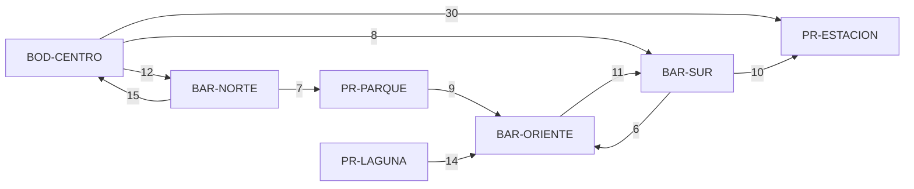

# Feature 2 — Modelado del recorrido de cobertura

## 1. La pregunta del negocio, en lenguaje de grafos

"¿A qué puntos puedo llegar desde la bodega?" = **¿qué nodos son alcanzables desde un nodo origen
siguiendo las aristas en su sentido?** No importa el costo, solo si existe al menos un camino.

El grafo no cambia respecto a la Feature 1: **dirigido, ponderado, sin lazos, guardado como lista
de adyacencia** `{punto: {destino: costo}}`. La cobertura **ignora el peso**: solo usa las flechas.

## 2. Recorrido por capas (BFS) vs exploración profunda (DFS)

| Criterio | Por capas (BFS) — **elegido** | Profundo (DFS) |
|----------|-------------------------------|----------------|
| ¿Encuentra todos los alcanzables? | Sí | Sí |
| Complejidad | O(V + E) | O(V + E) |
| Estructura auxiliar | Cola (FIFO) | Pila o recursión |
| Orden de visita | Por distancia en **número de trayectos**: primero los vecinos directos, luego los de 2 trayectos… | Sigue una rama hasta el fondo antes de volver |
| Información extra útil | `saltos` de cada punto y un camino de evidencia con **menos trayectos** | Un camino cualquiera, que puede ser muy largo |
| Riesgo en Python | Ninguno (bucle con `deque`) | La versión recursiva puede superar el límite de recursión en redes grandes |
| Explicarlo en el pitch | "Primero lo que está a 1 trayecto, luego a 2…" (capas) | Más difícil de seguir en una traza |

**Decisión:** BFS. Ambos resuelven la cobertura con el mismo costo, pero las capas responden de
paso "¿a cuántos trayectos está?" y la traza es más fácil de leer para el despachador.

### Por qué NO se usa Dijkstra aquí (pista del brief)

El cliente pide **cobertura**, no la ruta más barata. Dijkstra necesita una cola de prioridad y los
costos, y respondería otra pregunta. Además, el camino que devuelve el BFS es el de **menos
trayectos**, que **no** es el de menor costo:

| Camino a `PR-ESTACION` | Trayectos | Costo |
|------------------------|-----------|-------|
| `BOD-CENTRO → PR-ESTACION` (el que devuelve el BFS) | 1 | 30 min |
| `BOD-CENTRO → BAR-SUR → PR-ESTACION` | 2 | 18 min |

Por eso la API acompaña el `camino` con una `nota` que remite a la Feature 3 y no devuelve costo acumulado.

## 3. El algoritmo en `backend/red.py`

`RedOperativa._recorrer_por_capas` (línea 307):

```text
capa        = {origen: 0}          # también funciona como "conocidos"
llega_desde = {origen: None}       # para reconstruir el camino de evidencia
cola        = [origen]
mientras la cola no esté vacía:
    actual = sacar el primero de la cola           # FIFO → recorrido por capas
    anotar actual en el orden de visita
    para cada vecino en las salidas de actual:     # O(grado) gracias a la lista de adyacencia
        si vecino ya es conocido → ignorarlo        # evita repetir y cortar ciclos
        si no → capa[vecino] = capa[actual] + 1
                llega_desde[vecino] = actual
                meter vecino al final de la cola
```

Detalles que hay que saber explicar:

1. **Se marca al descubrir, no al visitar** (líneas 330–333). Si se marcara al visitar, un punto con
   dos entradas podría entrar dos veces a la cola.
2. **Los ciclos no son problema**: al volver a un punto conocido simplemente se ignora.
3. **El orden de los vecinos** es el orden en que se registraron las conexiones (los diccionarios de
   Python conservan el orden de inserción). Por eso la traza es reproducible.
4. **Explicación de no alcanzable** (`_explicar_no_alcanzable`, línea 378): se revisa, en este orden,
   si el origen no tiene salidas, si el destino no tiene entradas, o desde qué puntos se entra al
   destino (ninguno de ellos fue alcanzado).

### Complejidad

`V` = puntos, `E` = conexiones.

| Operación | Tiempo | Memoria extra |
|-----------|--------|---------------|
| Recorrido BFS completo | **O(V + E)**: cada punto entra una vez a la cola y cada conexión se revisa una vez | O(V): `capa`, `llega_desde`, cola |
| Reconstruir el camino de evidencia | O(longitud del camino) ≤ O(V) | O(V) |
| Explicar un destino no alcanzable | O(V + E): buscar quién apunta al destino | O(V) |
| Con matriz de adyacencia (comparación) | O(V²): habría que revisar la fila completa de cada punto | — |

## 4. Ejemplo pequeño (red de `datos/red_ejemplo.json`)



## 5. Traza: cobertura desde `BOD-CENTRO`

Generada por el código (`GET /api/cobertura/BOD-CENTRO`, campo `traza`) y verificada a mano.

| Paso | Visita (capa) | Vecinos revisados | Cola después | Decisión |
|------|---------------|-------------------|--------------|----------|
| 0 | — | — | `[BOD-CENTRO]` | Se marca el origen con capa 0 |
| 1 | BOD-CENTRO (0) | BAR-NORTE, BAR-SUR, PR-ESTACION | `[BAR-NORTE, BAR-SUR, PR-ESTACION]` | Los tres son nuevos: capa 1, se agregan a la cola |
| 2 | BAR-NORTE (1) | BOD-CENTRO, PR-PARQUE | `[BAR-SUR, PR-ESTACION, PR-PARQUE]` | BOD-CENTRO ya es conocido (ciclo de ida y vuelta) → se ignora; PR-PARQUE nuevo → capa 2 |
| 3 | BAR-SUR (1) | PR-ESTACION, BAR-ORIENTE | `[PR-ESTACION, PR-PARQUE, BAR-ORIENTE]` | PR-ESTACION ya conocido → se ignora; BAR-ORIENTE nuevo → capa 2 |
| 4 | PR-ESTACION (1) | (ninguno) | `[PR-PARQUE, BAR-ORIENTE]` | No tiene salidas |
| 5 | PR-PARQUE (2) | BAR-ORIENTE | `[BAR-ORIENTE]` | BAR-ORIENTE ya conocido → se ignora |
| 6 | BAR-ORIENTE (2) | BAR-SUR | `[]` | BAR-SUR ya conocido (ciclo BAR-SUR ⇄ BAR-ORIENTE) → se ignora. Cola vacía: fin |

**Orden de visita:** BOD-CENTRO → BAR-NORTE → BAR-SUR → PR-ESTACION → PR-PARQUE → BAR-ORIENTE

**Capas:** 0: BOD-CENTRO · 1: BAR-NORTE, BAR-SUR, PR-ESTACION · 2: PR-PARQUE, BAR-ORIENTE

**Decisión tomada:** desde la bodega se cubren **5 de 6** puntos. **PR-LAGUNA no es alcanzable**
porque ningún trayecto llega a él (solo tiene una salida hacia BAR-ORIENTE). El despachador no
debe aceptar pedidos para PR-LAGUNA desde BOD-CENTRO hasta que el coordinador registre un trayecto
de entrada.

## 6. Traza corta: verificación `BAR-SUR → BAR-NORTE` (la dirección importa)

| Paso | Visita (capa) | Vecinos revisados | Cola después | Decisión |
|------|---------------|-------------------|--------------|----------|
| 1 | BAR-SUR (0) | PR-ESTACION, BAR-ORIENTE | `[PR-ESTACION, BAR-ORIENTE]` | Ambos nuevos → capa 1 |
| 2 | PR-ESTACION (1) | (ninguno) | `[BAR-ORIENTE]` | Sin salidas |
| 3 | BAR-ORIENTE (1) | BAR-SUR | `[]` | BAR-SUR es el origen (conocido) → se ignora. Cola vacía: fin |

**Decisión:** BAR-NORTE nunca se descubrió → **no alcanzable**. A BAR-NORTE solo se entra desde
BOD-CENTRO, y BOD-CENTRO no es alcanzable desde BAR-SUR. En cambio `BAR-NORTE → BAR-SUR` **sí** es
alcanzable (BAR-NORTE → BOD-CENTRO → BAR-SUR): la cobertura en un grafo dirigido no es simétrica.

## 7. Casos borde y respuesta del sistema

| Caso | Respuesta |
|------|-----------|
| Red vacía | 404 `red_vacia` |
| Origen o destino no registrado | 404 `punto_inexistente` (dice cuál) |
| Origen o destino mal escrito (`BAR NORTE`) | 400 `dato_invalido` |
| Origen sin salidas (`PR-ESTACION`) | 200, 0 alcanzables, mensaje "no tiene trayectos de salida" |
| Destino sin entradas (`PR-LAGUNA`) | 200, `alcanzable: false`, explicación "no tiene conexiones de entrada" |
| Destino en otro componente | 200, `alcanzable: false`, explicación con los puntos que entran al destino |
| Origen = destino | 200, `alcanzable: true`, 0 saltos |
| Ciclos | El recorrido termina; cada punto se visita una vez |
