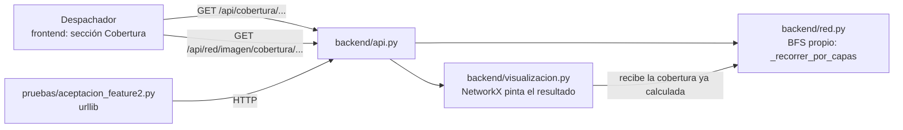

# Feature 2 — Plan técnico

## 1. Qué cambia en la arquitectura

Nada estructural: la Feature 2 agrega **una capacidad nueva** sobre el mismo grafo de la Feature 1.



| Capa | Archivo | Cambio |
|------|---------|--------|
| Núcleo | `backend/red.py` | `cobertura`, `verificar_cobertura`, `_recorrer_por_capas` (BFS con `collections.deque`), error `RedVacia` |
| API | `backend/api.py` | Rutas `GET /api/cobertura`, `/api/cobertura/{origen}`, `/api/cobertura/{origen}/{destino}` y `/api/red/imagen/cobertura/{origen}`; `red_vacia` → 404 |
| Visualización | `backend/visualizacion.py` | `dibujar_red(red, cobertura)` resalta el resultado ya calculado (misma semilla de posiciones que la vista normal) |
| Pruebas | `pruebas/aceptacion_feature2.py` | 28 escenarios con `urllib`; salida en `pruebas/salidas/aceptacion_feature2.txt`. Prueba manual de la interfaz en `pruebas/prueba_manual_interfaz_feature2.md` |
| Documentación | `docs/feature-2/` | Especificación, modelado con traza y este plan |
| Interfaz | `frontend/` | Sección **Cobertura de entregas**: formulario origen/destino, veredicto, tablas, traza y la imagen resaltada en la vista del grafo |

Se sigue usando solo la biblioteca estándar (`collections.deque` es parte de ella).

## 2. Tareas (backlog de la Feature 2)

| # | Tarea | Criterios | Responsable | PR / rama |
|---|-------|-----------|-------------|-----------|
| T1 | Especificación y modelado (BFS vs DFS, traza) | CA-28 | Persona 1 | PR1 · `docs/feature-2-especificacion` |
| T2 | Núcleo: recorrido por capas y explicación de no alcanzable | CA-17 a CA-22, CA-27 | Persona 1 | PR2 · `feature/2-nucleo-cobertura` |
| T3 | API REST de cobertura, errores y script de aceptación | CA-23 a CA-26 | Persona 2 | PR3 · `feature/2-api-cobertura` |
| T4 | Imagen con la cobertura resaltada | CA-30 | Persona 2 | PR4 · `feature/2-visualizacion-cobertura` |
| T5 | Interfaz: sección "Cobertura de entregas" y prueba manual | CA-29, CA-31 | Persona 2 | PR5 · `feature/2-interfaz-cobertura` |
| T6 | README y bitácora de IA | — | Persona 1 | PR6 · `docs/2-cierre-feature` |
| T7 | Revisión cruzada: cada PR lo aprueba la otra persona | — | Ambos | todos |
| T8 | Pitch | — | Ambos | — |

El estado de cada tarea se sigue en los Pull Requests de GitHub: una tarea está hecha cuando su PR se fusiona en `main`.

## 3. Cómo probarlo

```bash
python main.py --ejemplo                  # terminal 1
python pruebas/aceptacion_feature2.py     # terminal 2 → 28/28
python pruebas/aceptacion_feature1.py     # regresión de la Feature 1 → 33/33
```

Consulta manual desde PowerShell:

```powershell
Invoke-RestMethod http://127.0.0.1:8000/api/cobertura/BOD-CENTRO
Invoke-RestMethod http://127.0.0.1:8000/api/cobertura/BOD-CENTRO/PR-LAGUNA
```

## 4. Riesgos

| Riesgo | Mitigación |
|--------|-----------|
| Confundir cobertura con ruta más barata | El BFS ignora el costo, la respuesta no da costo acumulado y trae una `nota` explícita (CA-27) |
| Ciclos que provocan bucles infinitos | Marcar al descubrir; escenario 16 del script |
| Respuestas grandes en redes grandes (traza completa) | Aceptable con datos sintéticos pequeños; si crece, se puede ofrecer la traza solo bajo demanda |
