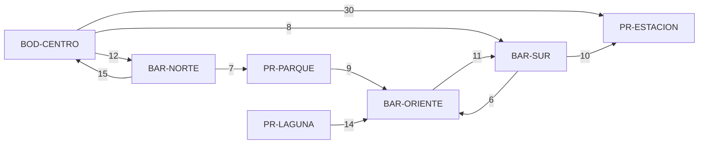

# Feature 3 — Modelado de la ruta de menor costo

## 1. La pregunta del negocio, en lenguaje de grafos

"¿Por dónde me sale más barato llevar el pedido?" = **¿cuál es el camino de peso mínimo entre dos
nodos de un grafo dirigido ponderado?** (problema del *camino más corto* desde un origen).

El grafo no cambia respecto a las Features 1 y 2: **dirigido, ponderado, con pesos positivos, sin
lazos, guardado como lista de adyacencia** `{punto: {destino: costo}}`. La diferencia es que ahora
el **peso sí importa**:

```
costo(camino v0 → v1 → … → vk) = costo(v0,v1) + costo(v1,v2) + … + costo(vk-1,vk)
```

| Feature | Qué mide un camino | Algoritmo |
|---------|-------------------|-----------|
| 2 · Cobertura | Número de trayectos (cada arista "vale 1") | BFS |
| 3 · Ruta de menor costo | **Suma de minutos** (cada arista vale su costo) | **Dijkstra** |

## 2. ¿Por qué Dijkstra?

| Criterio | BFS | **Dijkstra (elegido)** | Bellman-Ford | Floyd-Warshall |
|----------|-----|------------------------|--------------|----------------|
| ¿Usa los pesos? | No | Sí | Sí | Sí |
| Pesos permitidos | — | **≥ 0** (aquí > 0) | Negativos también | Negativos también |
| Complejidad | O(V + E) | **O((V + E) log V)** con montículo | O(V · E) | O(V³) |
| Responde | Menos trayectos | Menor costo desde **un** origen | Igual que Dijkstra, más lento | Menor costo entre **todos** los pares |
| ¿Sirve aquí? | No: da la ruta de menos saltos | **Sí** | Sí, pero más lento sin ganar nada | No: el despachador pregunta un par a la vez |

**Decisión:** Dijkstra. La regla R-05 (costo > 0, desde la Feature 1) garantiza su condición, es el
más rápido para un origen y su traza se explica con una frase: *"siempre cierro el punto pendiente
más barato"*.

### Por qué necesita pesos positivos (y por qué se valida otra vez)

Cuando Dijkstra saca del montículo el punto pendiente `u` con menor costo, lo declara **definitivo**.
Cualquier otro camino hacia `u` tendría que pasar por otro punto pendiente `x`, que ya cuesta **al
menos lo mismo** que `u`; como todo trayecto suma un costo **positivo**, ese camino solo puede salir
**más caro**. Por eso nadie puede mejorar a `u` después.

Con un costo negativo esa garantía se rompe: un camino "caro al principio" podría abaratarse luego y
Dijkstra ya habría cerrado el punto con un valor equivocado. Por eso:

- `agregar_conexion` rechaza costos ≤ 0 (R-05, Feature 1).
- `ruta_menor_costo` llama a `_exigir_costos_positivos` (`backend/red.py`, línea 565) **antes** de
  calcular: si encuentra un costo inválido responde 400 sin dar una ruta incorrecta (R-18).

## 3. El algoritmo en `backend/red.py`

`RedOperativa._buscar_menor_costo` (línea 444):

```text
costo_acumulado = {origen: 0}         # mejor costo conocido hasta cada punto
llega_desde     = {origen: None}      # PREDECESOR: dato que permite reconstruir la ruta
definitivos     = {}                  # puntos cuyo costo ya no puede mejorar
monticulo       = [(0, origen)]       # cola de prioridad: sale siempre el menor costo
mientras el montículo no esté vacío:
    (costo, actual) = sacar el menor                  # heapq.heappop → O(log V)
    si actual ya es definitivo → ignorar (entrada vieja)
    marcar actual como definitivo
    si actual es el destino → terminar
    para cada vecino en las salidas de actual:        # O(grado) gracias a la lista de adyacencia
        si vecino es definitivo → no cambia
        nuevo = costo + costo(actual → vecino)
        si nuevo < costo_acumulado[vecino] (o no tenía):   # RELAJACIÓN
            costo_acumulado[vecino] = nuevo
            llega_desde[vecino] = actual
            meter (nuevo, vecino) al montículo
```

Detalles que hay que saber explicar:

1. **Qué dato se conserva para reconstruir la ruta:** el **predecesor** `llega_desde[p]`. Al terminar
   se camina desde el destino hacia atrás (`destino ← … ← origen`) y se invierte. Se reutiliza
   `_reconstruir_camino` de la Feature 2 (línea 367). Funciona porque **todo tramo de una ruta mínima
   también es mínimo** (subestructura óptima): el mejor camino a PR-ESTACION pasa por el mejor camino
   a BAR-SUR.
2. **Eliminación perezosa** (línea 467): al mejorar un costo no se busca la entrada vieja dentro del
   montículo; se agrega una nueva y la vieja se ignora cuando sale, porque el punto ya es definitivo.
3. **Desempate reproducible:** las entradas son `(costo, orden de llegada, punto)`. Si dos puntos
   cuestan lo mismo sale primero el que llegó antes, así la traza siempre es igual.
4. **Parada temprana:** cuando el destino sale del montículo su costo es definitivo y se termina.
   Si el montículo se vacía sin sacarlo, **no existe ruta** y se explica con
   `_explicar_no_alcanzable` de la Feature 2.
5. **Comparación con menos saltos** (`_comparar_con_menos_saltos`, línea 534): se ejecuta el BFS de
   la Feature 2 para el mismo origen, se reconstruye su camino y se suma su costo. La Feature 2 **no
   se modificó**: solo se reutiliza.

### Complejidad

`V` = puntos, `E` = conexiones.

| Operación | Tiempo | Memoria extra |
|-----------|--------|---------------|
| Validar costos (R-18) | O(E) | O(1) |
| Dijkstra con `heapq` y eliminación perezosa | **O((V + E) log V)**: cada conexión puede meter una entrada al montículo y cada entrada cuesta O(log V) | O(V + E): costos, predecesores y montículo |
| Reconstruir la ruta | O(longitud de la ruta) ≤ O(V) | O(V) |
| Comparar con menos saltos (BFS) | O(V + E) | O(V) |
| Con matriz de adyacencia (comparación) | O(V²) solo para revisar vecinos | — |

## 4. Ejemplo pequeño (red de `datos/red_ejemplo.json`)



Dos caminos de `BOD-CENTRO` a `PR-ESTACION` con distinto número de saltos y costo:

| Camino | Saltos | Costo | ¿Quién lo elige? |
|--------|--------|-------|------------------|
| `BOD-CENTRO → PR-ESTACION` | **1** | 30 min | BFS (Feature 2): menos trayectos |
| `BOD-CENTRO → BAR-SUR → PR-ESTACION` | 2 | **18 min** | **Dijkstra (Feature 3)**: menor costo |

## 5. Traza: ruta de `BOD-CENTRO` a `PR-ESTACION`

Generada por el código (`GET /api/ruta/BOD-CENTRO/PR-ESTACION`, campo `traza`) y verificada a mano.
`∞` = todavía sin costo conocido. Abreviaturas: B = BOD-CENTRO, N = BAR-NORTE, S = BAR-SUR,
E = PR-ESTACION, O = BAR-ORIENTE, P = PR-PARQUE.

| Paso | Sale del montículo (definitivo) | Revisa salidas | Costos después | Pendientes en el montículo | Decisión |
|------|-------------------------------|----------------|----------------|----------------------------|----------|
| 0 | — | — | B=0, resto ∞ | `(0,B)` | Se inicia el origen con costo 0 |
| 1 | **B (0)** | N: 0+12=12 < ∞ ✔ · S: 0+8=8 < ∞ ✔ · E: 0+30=30 < ∞ ✔ | N=12, S=8, E=30 | S 8 · N 12 · E 30 | Mejora los tres; predecesor de N, S y E = B |
| 2 | **S (8)** | E: 8+10=**18 < 30** ✔ · O: 8+6=14 < ∞ ✔ | **E=18**, O=14 | N 12 · O 14 · E 18 | **Relajación clave:** pasar por S abarata E; predecesor de E pasa de B a **S** |
| 3 | **N (12)** | B: definitivo → no cambia · P: 12+7=19 < ∞ ✔ | P=19 | O 14 · E 18 · P 19 | El regreso a B (ciclo) se ignora |
| 4 | **O (14)** | S: definitivo → no cambia | sin cambios | E 18 · P 19 | El ciclo S ⇄ O no reabre S |
| 5 | **E (18)** = destino | — | — | P 19 | El destino es definitivo: **fin** |

La entrada vieja `(30, E)` quedó en el montículo, pero nunca se usa (eliminación perezosa).

**Reconstrucción con predecesores:** `E ← S ← B` → se invierte → **`BOD-CENTRO → BAR-SUR → PR-ESTACION`, 18 min.**

**Decisión tomada:** despachar por BAR-SUR. El trayecto directo tiene un solo salto pero cuesta 30
min; la ruta elegida tiene 2 saltos y cuesta 18 min: **ahorra 12 minutos**. Por eso la respuesta
trae `comparacion_menos_saltos` con `diferencia: 12`.

## 6. Traza corta: un ciclo en el camino (`BAR-NORTE → BAR-SUR`)

| Paso | Definitivo | Revisa salidas | Costos después | Decisión |
|------|------------|----------------|----------------|----------|
| 1 | N (0) | B: 15 ✔ · P: 7 ✔ | B=15, P=7 | Mejora ambos |
| 2 | P (7) | O: 7+9=16 ✔ | O=16 | — |
| 3 | B (15) | N: definitivo · S: 15+8=23 ✔ · E: 15+30=45 ✔ | S=23, E=45 | El regreso a N se ignora |
| 4 | O (16) | S: 16+11=27 ✘ (no mejora 23) | sin cambios | Se descarta el camino por el oriente |
| 5 | S (23) = destino | — | — | Fin |

**Ruta:** `BAR-NORTE → BOD-CENTRO → BAR-SUR`, **23 min** (2 saltos) frente a
`BAR-NORTE → PR-PARQUE → BAR-ORIENTE → BAR-SUR`, 27 min (3 saltos). Aquí el de menos saltos **sí**
es el más barato: la lección no es que siempre cambie, sino que **no está garantizado**.

## 7. Casos borde y respuesta del sistema

| Caso | Respuesta |
|------|-----------|
| Red vacía | 404 `red_vacia` |
| Origen o destino no registrado | 404 `punto_inexistente` (dice cuál) |
| Origen o destino mal escrito (`BAR NORTE`) | 400 `dato_invalido` |
| Falta el destino (`/api/ruta/BOD-CENTRO`) o ambos (`/api/ruta`) | 400 `formato_incorrecto` |
| Destino sin entradas (`PR-LAGUNA`) | 200, `existe_ruta: false`, "no tiene conexiones de entrada" |
| Origen sin salidas (`PR-ESTACION`) | 200, `existe_ruta: false`, "no tiene trayectos de salida" |
| Solo existe el sentido contrario (`BAR-SUR → BAR-NORTE`) | 200, `existe_ruta: false`, explica desde dónde se entra al destino |
| Origen = destino | 200, `camino: [origen]`, costo 0, 0 saltos |
| Ciclos | Termina: un punto definitivo nunca se reabre |
| Registrar un costo ≤ 0 o no numérico | 400 `dato_invalido` (la ruta no cambia) |
| Costo inválido ya presente en memoria | 400 `dato_invalido`: "Dijkstra solo funciona con costos mayores que 0" |
| Empate de costo entre dos rutas | Se devuelve la que se descubre primero (orden de registro) |

## 8. Adición: costo monetario en pesos colombianos (R-24 a R-27)

### ¿Cambia el grafo o el algoritmo?

**No.** El peso de cada arista sigue siendo **minutos**. El costo en pesos es una **conversión
posterior** con una sola tarifa fija por minuto (`COST_PER_MINUTE_COP = 200` en `backend/network.py`):

```
pesos(camino) = minutos(camino) × 200
```

Multiplicar todos los pesos de las aristas por la misma constante positiva **no cambia el orden**
de los caminos: si el camino A dura menos minutos que el B, también cuesta menos pesos. Por eso la
ruta de menor costo en minutos **es** la de menor costo en pesos, y Dijkstra no se toca: la tarifa
se aplica **después**, sobre la ruta ya calculada, y la traza sigue en minutos.

| Alternativa considerada | Por qué se descartó |
|-------------------------|---------------------|
| Cargo fijo por ruta (despacho) | No depende del recorrido: no ayuda a comparar alternativas |
| Cargo fijo por trayecto (tramo) | Pesos y minutos dejarían de ser proporcionales y habría que decidir qué se optimiza; eso es otra feature |
| **Tarifa por minuto (elegida)** | Proporcional al tiempo, se explica con una multiplicación y no altera Dijkstra |

### Ejemplo con la red de ejemplo (`BOD-CENTRO → PR-ESTACION`)

| Camino | Saltos | Minutos | Pesos (× 200) |
|--------|--------|---------|---------------|
| `BOD-CENTRO → BAR-SUR → PR-ESTACION` (Dijkstra) | 2 | **18** | **$3.600** |
| `BOD-CENTRO → PR-ESTACION` (menos saltos, BFS) | 1 | 30 | $6.000 |
| **Diferencia** | | 12 | **$2.400** |

Tramos de la ruta elegida:

| Tramo | Minutos | Acumulado (min) | `costo_cop` | `acumulado_cop` |
|-------|---------|-----------------|-------------|-----------------|
| BOD-CENTRO → BAR-SUR | 8 | 8 | 1.600 | 1.600 |
| BAR-SUR → PR-ESTACION | 10 | 18 | 2.000 | 3.600 |

### Redondeo al peso (R-25)

Los minutos pueden tener decimales (por ejemplo 2.5 o 7.5), así que el producto podría tener
centavos. El peso colombiano se maneja sin centavos, así que se redondea al peso entero:

1. Los minutos se convierten con `Decimal(str(minutos))`. `Decimal(2.0025)`, sin `str`, copia el
   valor binario del `float` (`2.00249999999999994…`): por 200 da `400.4999…` y redondearía a **400**.
   Con `Decimal("2.0025")` el producto es exactamente `400.5000`.
2. Se redondea con `ROUND_HALF_UP` (0,5 sube): `400.5 → 401`. Se descarta `round()` de Python porque
   redondea "al par": `round(2.0025 * 200)` da **400** (y `round(2.5) == 2`), y eso sorprende en dinero.
3. `acumulado_cop` y `total` se calculan sobre los **minutos acumulados**, no sumando pesos ya
   redondeados. Así el error de redondeo no se acumula tramo a tramo; `total` es el valor válido.

Complejidad: O(1) para el total y O(longitud de la ruta) para los tramos, que ya se recorrían.

### Validación de la tarifa (R-26)

La tarifa es una constante del código y no la escribe el usuario, así que un valor inválido es un
**error de configuración**, no un `400` del cliente. Se valida **al importar** el módulo: si no es un
entero mayor que 0 (y no es `bool`), se lanza `ValueError` y el servidor no arranca. Es mejor no
arrancar que cotizar despachos con un precio absurdo.

### Casos borde de la adición

| Caso | Respuesta |
|------|-----------|
| Hay ruta | `costo_monetario: {moneda: "COP", tarifa_por_minuto: 200, total}` y pesos en tramos y comparación |
| No hay ruta | Sin `costo_monetario` (igual que sin `camino`) |
| Origen = destino | `costo_monetario.total: 0` |
| Minutos decimales con medio peso (2.0025 min) | `total: 401` (*half-up*) |
| Tarifa inválida en el código | El servidor no arranca: `ValueError` con mensaje claro |
