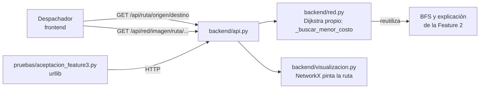

# Feature 3 — Plan técnico

## 1. Qué cambia en la arquitectura

Nada estructural: la Feature 3 agrega **una capacidad nueva** sobre el mismo grafo. Reutiliza piezas
de la Feature 2 (reconstrucción del camino, explicación de no alcanzable y el BFS para comparar) sin
modificar su comportamiento.



| Capa | Archivo | Cambio |
|------|---------|--------|
| Núcleo | `backend/red.py` | `ruta_menor_costo`, `_buscar_menor_costo` (Dijkstra con `heapq`), `_tramos_del_camino`, `_comparar_con_menos_saltos`, `_decision_de_relajacion`, `_exigir_costos_positivos` |
| API | `backend/api.py` | Rutas `GET /api/ruta`, `/api/ruta/{origen}`, `/api/ruta/{origen}/{destino}` y `/api/red/imagen/ruta/{origen}/{destino}`; `/api/salud` informa `feature: 3` |
| Visualización | `backend/visualizacion.py` | `dibujar_red(red, ruta=...)` resalta la ruta ya calculada; la cobertura y la ruta comparten la función `_resaltado` |
| Pruebas | `pruebas/aceptacion_feature3.py` | 32 escenarios con `urllib`; salida en `pruebas/salidas/aceptacion_feature3.txt` |
| Documentación | `docs/feature-3/` | Especificación, modelado con trazas y este plan |

Se sigue usando solo la biblioteca estándar (`heapq` es parte de ella).

## 2. Tareas (backlog del backend de la Feature 3)

| # | Tarea | Criterios | Responsable | PR / rama |
|---|-------|-----------|-------------|-----------|
| T1 | Especificación, modelado (Dijkstra vs alternativas, trazas) y plan | CA-46 | Persona 1 | PR1 · `docs/feature-3-especificacion` |
| T2 | Núcleo: Dijkstra, reconstrucción, comparación y validación de costos | CA-32 a CA-38, CA-44 | Persona 1 | PR2 · `feature/3-nucleo-ruta` |
| T3 | API REST de la ruta y script de aceptación | CA-39 a CA-43 | Persona 2 | PR3 · `feature/3-api-ruta` |
| T4 | Imagen con la ruta resaltada | CA-45 | Persona 2 | PR3 · `feature/3-api-ruta` |
| T5 | README, bitácora de IA e imagen de evidencia | — | Persona 1 | PR4 · `docs/3-cierre-feature` |
| T6 | Código del backend en inglés (sin cambiar el contrato de la API) | — | Persona 2 | PR5 · `refactor/codigo-en-ingles` |
| T7 | Revisión cruzada: cada PR lo aprueba la otra persona | — | Ambos | todos |

La interfaz web de la ruta queda para el equipo de frontend, sobre el contrato de la especificación.

## 3. Cómo probarlo

```bash
python main.py --ejemplo                  # terminal 1
python pruebas/aceptacion_feature3.py     # terminal 2 → 32/32
python pruebas/aceptacion_feature2.py     # regresión de la Feature 2 → 27/27
python pruebas/aceptacion_feature1.py     # regresión de la Feature 1 → 33/33
```

Consulta manual desde PowerShell:

```powershell
Invoke-RestMethod http://127.0.0.1:8000/api/ruta/BOD-CENTRO/PR-ESTACION
Invoke-RestMethod http://127.0.0.1:8000/api/ruta/BOD-CENTRO/PR-LAGUNA
```

### CA-44 (costo inválido ya en memoria)

La API nunca deja registrar un costo ≤ 0, así que este caso no se puede provocar por HTTP. Se
verifica en consola, forzando el dato a propósito:

```bash
python -c "import json; from backend.red import RedOperativa, DatoInvalido; r = RedOperativa(); r.cargar(json.load(open('datos/red_ejemplo.json', encoding='utf-8'))); r._adyacencia['BAR-SUR']['PR-PARQUE'] = -20; r.ruta_menor_costo('BOD-CENTRO', 'PR-PARQUE')"
```

Resultado esperado: `DatoInvalido: El trayecto BAR-SUR → PR-PARQUE tiene un costo inválido (-20)...`

## 4. Riesgos

| Riesgo | Mitigación |
|--------|-----------|
| Confundir ruta de menor costo con cobertura | Son dos endpoints y dos algoritmos; la respuesta de la ruta compara explícitamente con el camino de menos trayectos (R-22) |
| Un costo negativo daría rutas incorrectas sin avisar | Doble validación: al registrar (R-05) y antes de calcular (R-18) |
| Montículo con entradas repetidas | Eliminación perezosa: se ignoran al salir; la memoria sigue siendo O(V + E) |
| Errores de redondeo con costos decimales | Se suman en el mismo orden en que se reconstruye la ruta; escenario con 2.5 + 2.5 en el script |
| Traza muy larga en redes grandes | Aceptable con datos sintéticos pequeños; si crece, se puede ofrecer la traza bajo demanda |
