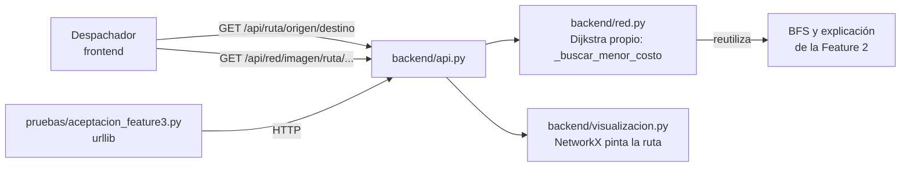

# Feature 3 — Plan técnico

## 1. Qué cambia en la arquitectura

Nada estructural: la Feature 3 agrega **una capacidad nueva** sobre el mismo grafo. Reutiliza piezas
de la Feature 2 (reconstrucción del camino, explicación de no alcanzable y el BFS para comparar) sin
modificar su comportamiento.



| Capa | Archivo | Cambio |
|------|---------|--------|
| Núcleo | `backend/red.py` | `ruta_menor_costo`, `_buscar_menor_costo` (Dijkstra con `heapq`), `_tramos_del_camino`, `_comparar_con_menos_saltos`, `_decision_de_relajacion`, `_exigir_costos_positivos` |
| API | `backend/api.py` | Rutas `GET /api/ruta`, `/api/ruta/{origen}`, `/api/ruta/{origen}/{destino}` y `/api/red/imagen/ruta/{origen}/{destino}`; `/api/salud` informa `feature: 3` |
| Visualización | `backend/visualizacion.py` | `dibujar_red(red, ruta=...)` resalta la ruta ya calculada; la cobertura y la ruta comparten la función `_resaltado` |
| Pruebas | `pruebas/aceptacion_feature3.py` | 32 escenarios con `urllib`; salida en `pruebas/salidas/aceptacion_feature3.txt` |
| Documentación | `docs/feature-3/` | Especificación, modelado con trazas y este plan |

Se sigue usando solo la biblioteca estándar (`heapq` es parte de ella).

## 2. Tareas (backlog del backend de la Feature 3)

| # | Tarea | Criterios | Responsable | PR / rama |
|---|-------|-----------|-------------|-----------|
| T1 | Especificación, modelado (Dijkstra vs alternativas, trazas) y plan | CA-46 | Persona 1 | PR1 · `docs/feature-3-especificacion` |
| T2 | Núcleo: Dijkstra, reconstrucción, comparación y validación de costos | CA-32 a CA-38, CA-44 | Persona 1 | PR2 · `feature/3-nucleo-ruta` |
| T3 | API REST de la ruta y script de aceptación | CA-39 a CA-43 | Persona 2 | PR3 · `feature/3-api-ruta` |
| T4 | Imagen con la ruta resaltada | CA-45 | Persona 2 | PR3 · `feature/3-api-ruta` |
| T5 | README, bitácora de IA e imagen de evidencia | — | Persona 1 | PR4 · `docs/3-cierre-feature` |
| T6 | Código del backend en inglés (sin cambiar el contrato de la API) | — | Persona 2 | PR5 · `refactor/codigo-en-ingles` |
| T7 | Revisión cruzada: cada PR lo aprueba la otra persona | — | Ambos | todos |

La interfaz web de la ruta queda para el equipo de frontend, sobre el contrato de la especificación.

## 3. Cómo probarlo

```bash
python main.py --ejemplo                  # terminal 1
python pruebas/aceptacion_feature3.py     # terminal 2 → 32/32
python pruebas/aceptacion_feature2.py     # regresión de la Feature 2 → 27/27
python pruebas/aceptacion_feature1.py     # regresión de la Feature 1 → 33/33
```

Consulta manual desde PowerShell:

```powershell
Invoke-RestMethod http://127.0.0.1:8000/api/ruta/BOD-CENTRO/PR-ESTACION
Invoke-RestMethod http://127.0.0.1:8000/api/ruta/BOD-CENTRO/PR-LAGUNA
```

### CA-44 (costo inválido ya en memoria)

La API nunca deja registrar un costo ≤ 0, así que este caso no se puede provocar por HTTP. Se
verifica en consola, forzando el dato a propósito:

```bash
python -c "import json; from backend.network import OperationalNetwork; r = OperationalNetwork(); r.load(json.load(open('datos/red_ejemplo.json', encoding='utf-8'))); r._adjacency['BAR-SUR']['PR-PARQUE'] = -20; r.cheapest_route('BOD-CENTRO', 'PR-PARQUE')"
```

Resultado esperado: `InvalidData: El trayecto BAR-SUR → PR-PARQUE tiene un costo inválido (-20)...`

## 4. Riesgos

| Riesgo | Mitigación |
|--------|-----------|
| Confundir ruta de menor costo con cobertura | Son dos endpoints y dos algoritmos; la respuesta de la ruta compara explícitamente con el camino de menos trayectos (R-22) |
| Un costo negativo daría rutas incorrectas sin avisar | Doble validación: al registrar (R-05) y antes de calcular (R-18) |
| Montículo con entradas repetidas | Eliminación perezosa: se ignoran al salir; la memoria sigue siendo O(V + E) |
| Errores de redondeo con costos decimales | Se suman en el mismo orden en que se reconstruye la ruta; escenario con 2.5 + 2.5 en el script |
| Traza muy larga en redes grandes | Aceptable con datos sintéticos pequeños; si crece, se puede ofrecer la traza bajo demanda |

## 5. Adición: costo monetario en COP (R-24 a R-27, CA-47 a CA-54)

Un solo Pull Request desde la rama `feature/3-adicion-costo`, con un commit por tarea y en este
orden. El primer commit es esta documentación, así la especificación queda antes que el código.

### Qué cambia

| Capa | Archivo | Cambio |
|------|---------|--------|
| Núcleo | `backend/network.py` | Constante `COST_PER_MINUTE_COP = 200`; `validate_cost_per_minute` (se llama al importar el módulo, R-26); conversión con `Decimal` y `ROUND_HALF_UP` (R-25); `costo_monetario` en `cheapest_route`; `costo_cop` y `acumulado_cop` en `_path_legs`; `costo_cop` y `diferencia_cop` en `_compare_with_fewest_hops`; mensajes con pesos |
| API | `backend/api.py` | Sin cambios esperados: reenvía lo que devuelve el núcleo. Se confirma al implementar |
| Pruebas | `pruebas/aceptacion_feature3.py` | Escenarios CA-47 a CA-52 y CA-54; salidas regeneradas de las Features 1, 2 y 3 |
| Interfaz | `frontend/legacy/` | Pesos en la vista de ruta (sobre la interfaz de la ruta que ya existe) |
| Documentación | `docs/feature-3/`, `docs/ia/bitacora-feature-3.md`, `README.md` | Especificación, modelado (sección 8), este plan, bitácora y README |

Visualización (`backend/visualization.py`) y `/api/salud` **no** cambian.

### Tareas

| # | Tarea | Criterios | Commit |
|---|-------|-----------|--------|
| T8 | Especificación (HU-14, R-24 a R-27, CA-47 a CA-54, contrato), modelado (sección 8) y este plan | — | `docs: especificación del costo monetario de la ruta` |
| T9 | Núcleo: constante, validación al importar, redondeo y campos en COP | CA-47 a CA-53 | `feat: costo monetario en COP de la ruta de menor costo` |
| T10 | Escenarios de aceptación y salidas regeneradas (también `aceptacion_feature2.txt`) | CA-47 a CA-52, CA-54 | `test: escenarios del costo monetario de la ruta` |
| T11a | Interfaz de la ruta en `frontend/legacy` (los cambios que ya existían, en su propio commit) | — | `feat: interfaz de la ruta en el frontend legacy` |
| T11b | Pesos en la interfaz legacy | — | `feat: costo en COP en la vista de ruta del frontend legacy` |
| T12 | Bitácora de IA (fila 11 en adelante), README y verificación de CA-53 | — | `docs: bitácora y README del costo monetario` |

### Interfaz `frontend/legacy` (T11b)

- Formato: `Intl.NumberFormat("es-CO", { style: "currency", currency: "COP", maximumFractionDigits: 0 })`.
- Título: *"Ruta elegida · 18 min · $ 3.600 en 2 trayecto(s)"*.
- Tabla de tramos: columnas nuevas **COP** y **Acumulado COP**.
- Comparación: *"30 min · $ 6.000"* y la diferencia en minutos y pesos.
- Nota con la tarifa: *"Tarifa: $ 200 por minuto"*, tomada de `costo_monetario.tarifa_por_minuto`.
- La traza y los costos definitivos siguen en minutos.

### Cómo probarlo

```bash
python main.py --ejemplo                  # terminal 1
python pruebas/aceptacion_feature3.py     # terminal 2 → 32 escenarios anteriores + los nuevos
python pruebas/aceptacion_feature2.py     # regresión → 27/27
python pruebas/aceptacion_feature1.py     # regresión → 33/33
```

#### CA-53 (tarifa inválida)

La tarifa es una constante del código, así que no se puede provocar por HTTP. Se verifica en consola
llamando a la misma validación que se ejecuta al importar el módulo:

```bash
python -c "from backend.network import validate_cost_per_minute; validate_cost_per_minute(0)"
```

Resultado esperado: `ValueError: COST_PER_MINUTE_COP debe ser un entero mayor que 0 (pesos colombianos por minuto). Se encontró 0.`
También con `-200`, `200.5`, `"200"` y `True`.

### Riesgos de la adición

| Riesgo | Mitigación |
|--------|-----------|
| Confundir minutos con pesos en el contrato | Los campos en minutos no cambian; los nuevos llevan `_cop` o van dentro de `costo_monetario` con `moneda: "COP"` |
| Redondeo incorrecto por punto flotante | `Decimal(str(minutos))` y `ROUND_HALF_UP`; escenario CA-52 con 2.0025 min → 401 |
| Romper escenarios existentes | Solo se agregan campos y texto a los mensajes; el script compara números, no mensajes. CA-54 corre las regresiones |
| Tarifa cambiada por error a un valor absurdo | Validación al importar: el servidor no arranca (R-26) |
