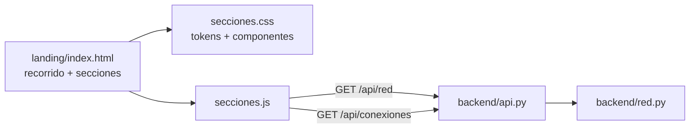

# Landing · Secciones de cierre — Plan técnico

> Basado en [`especificacion.md`](especificacion.md). Se implementa solo cuando el equipo la apruebe.
> Alcance: S1 (cifras en vivo), S2 (antes y después) y S3 (equipo y pie de página).

## 1. Branding actual del frontend

Inventario de lo que **ya usa** el proyecto hoy. Las secciones nuevas parten de aquí; no se
inventa una identidad nueva.

### 1.1 Colores

**Landing** (`frontend/landing/index.html`, tema blueprint aprobado):

| Token          | Valor     | Uso actual                                          |
|----------------|-----------|-----------------------------------------------------|
| `--sw-bg`      | `#0146C1` | Fondo de la página y de las escenas                 |
| `--sw-ink`     | `#E3E5FC` | Línea de las escenas, títulos, relleno de botones   |
| `--sw-ink-soft`| `#B9C2F0` | Textos secundarios, pista de scroll                 |
| `--sw-accent`  | `#E3E5FC` | Eyebrows, puntos de navegación, barra de progreso   |
| texto de botón | `#0146C1` | Texto azul sobre botón claro (`.sw-btn--primary`)   |

**Interfaz** (`frontend/estilos.css`):

| Token              | Claro     | Oscuro    | Uso                         |
|--------------------|-----------|-----------|-----------------------------|
| `--primario`       | `#1e3a8a` | `#3b82f6` | Botones, enlaces            |
| `--primario-hover` | `#1d4ed8` | `#60a5fa` | Hover                       |
| `--exito`          | `#15803d` | —         | Mensajes correctos          |
| `--peligro`        | `#b91c1c` | —         | Errores                     |
| `--bodega`         | `#e4572e` | —         | Nodo tipo bodega            |
| `--barrio`         | `#2e86ab` | —         | Nodo tipo barrio            |
| `--punto_recogida` | `#3bb273` | —         | Nodo tipo punto de recogida |
| barra superior     | `linear-gradient(120deg, #1e3a8a, #0f766e)` | | Encabezado |

### 1.2 Tipografía

| Rol      | Landing                                        | Interfaz                                         |
|----------|------------------------------------------------|--------------------------------------------------|
| Títulos  | `"Inter Tight"`, 700 (`--sw-font-display`)     | `system-ui, "Segoe UI", Roboto`                  |
| Cuerpo   | `"Manrope"` (`--sw-font-body`)                 | `system-ui, "Segoe UI", Roboto`                  |
| Código   | `ui-monospace, Menlo`                          | `ui-monospace, "Cascadia Code", Consolas`        |
| Eyebrow  | Inter Tight 700 · `.8rem` · `letter-spacing .16em` · MAYÚSCULAS | — |

> **Hallazgo:** `scrub-engine.js` declara Inter Tight y Manrope pero **nadie las carga**
> (no hay `<link>` a Google Fonts). Hoy la landing se ve en la fuente del sistema.
> Tarea L2 las carga con `preconnect` + `display=swap`.

### 1.3 Logo

| Dónde    | Qué es                                                                 |
|----------|------------------------------------------------------------------------|
| Interfaz | SVG propio de 32×32: **tres nodos unidos por tres trayectos** (un grafo). Trazo 2 px, extremos redondeados, `currentColor`. |
| Landing  | `.sw-brand__mark`: una pastilla con degradado, genérica del motor; **no** es el logo de RutaPyme. |

```html
<svg viewBox="0 0 32 32" aria-hidden="true">
  <circle cx="7" cy="8" r="4"/><circle cx="25" cy="10" r="4"/><circle cx="14" cy="25" r="4"/>
  <path d="M10.5 9 L21 10 M23 13.5 L16.5 22 M12 21.5 L8 11.5"/>
</svg>
```

**Decisión:** las secciones nuevas usan el SVG del grafo como logo oficial (en S3 y como marca de
agua de S1). Unificar el logo de la barra superior del recorrido queda como mejora opcional (L9).

### 1.4 Tokens para las secciones nuevas

Se declaran una sola vez en `secciones.css` y se derivan de lo anterior:

```css
.landing-secciones {
  /* Marca (heredada) */
  --ls-fondo:        #0146C1;              /* = --sw-bg */
  --ls-tinta:        #E3E5FC;              /* = --sw-ink */
  --ls-tinta-suave:  #B9C2F0;              /* = --sw-ink-soft */
  --ls-fondo-hondo:  #01359A;              /* fondo -10 % luz, para profundidad */
  /* Superficies */
  --ls-superficie:   rgb(227 229 252 / 0.06);
  --ls-superficie-2: rgb(227 229 252 / 0.10);
  --ls-borde:        rgb(227 229 252 / 0.16);
  --ls-borde-fuerte: rgb(227 229 252 / 0.32);
  /* Estados (de la interfaz, aclarados para fondo azul y contraste AA) */
  --ls-exito:        #86efac;
  --ls-cerrado:      #fca5a5;
  /* Tipos de punto (de la interfaz) */
  --ls-bodega:       #e4572e;
  --ls-barrio:       #2e86ab;
  --ls-recogida:     #3bb273;
  /* Tipografía */
  --ls-fuente-titulo: "Inter Tight", system-ui, sans-serif;
  --ls-fuente-texto:  "Manrope", system-ui, sans-serif;
  --ls-fuente-codigo: ui-monospace, "Cascadia Code", Consolas, monospace;
  /* Forma y movimiento */
  --ls-radio:    20px;
  --ls-radio-sm: 12px;
  --ls-sombra:   0 1px 0 rgb(227 229 252 / 0.08) inset, 0 24px 48px -24px rgb(0 20 70 / 0.55);
  --ls-curva:    cubic-bezier(.2, .8, .2, 1);
}
```

Escala tipográfica (fluida con `clamp`):

| Nivel        | Fuente      | Tamaño                         | Peso | Extra                         |
|--------------|-------------|--------------------------------|------|-------------------------------|
| Cifra grande | Inter Tight | `clamp(2.75rem, 6vw, 4.5rem)`  | 700  | `font-variant-numeric: tabular-nums`, `letter-spacing -0.03em` |
| Título H2    | Inter Tight | `clamp(1.9rem, 4vw, 3rem)`     | 700  | `letter-spacing -0.02em`, `text-wrap: balance` |
| Eyebrow      | Inter Tight | `.78rem`                       | 700  | MAYÚSCULAS, `letter-spacing .16em` (igual al recorrido) |
| Cuerpo       | Manrope     | `clamp(1rem, 1.2vw, 1.1rem)`   | 400  | `line-height 1.6`, máx. `60ch` |
| Etiqueta     | Manrope     | `.85rem`                       | 600  | color `--ls-tinta-suave`      |
| Id de punto  | monoespacio | `.85rem`                       | 600  | `BOD-CENTRO`, `BAR-SUR`…      |

## 2. Dirección visual: moderna, coherente con el blueprint

Principios (sin salirse del estilo aprobado: azul + línea clara, **sin cuadrícula**):

1. **Bento en vez de tarjetas iguales.** S1 usa una rejilla asimétrica: la cifra principal ocupa
   2 celdas; las demás, 1.
2. **Superficies de vidrio sobre azul.** Tarjetas con `--ls-superficie`, borde de 1 px
   `--ls-borde` y `backdrop-filter: blur(12px)`; sin sombras grises.
3. **Tipografía protagonista.** Cifras enormes con números tabulares; poco texto alrededor.
4. **Línea como en las escenas.** Los trayectos de S2 se dibujan con SVG de trazo claro (como
   las escenas), y el tramo cerrado con trazo punteado.
5. **Movimiento con propósito.** Las cifras cuentan de 0 al valor (600 ms); los tramos de S2 se
   dibujan uno tras otro (`stroke-dashoffset`); las tarjetas suben 8 px al entrar.
   Todo se desactiva con `prefers-reduced-motion: reduce`.
6. **Accesibilidad.** Contraste AA de `--ls-tinta` sobre `--ls-fondo` (≈ 6,4 : 1);
   foco visible con `outline: 2px solid var(--ls-tinta); outline-offset: 3px`;
   el estado de carga se anuncia con `aria-live="polite"`.

### 2.1 S1 · Cifras de la red en vivo

```
┌─ EYEBROW: LA RED, AHORA MISMO ───────────────── ● En vivo · Actualizar ┐
│ ┌───────────────────────────────┐ ┌──────────────┐ ┌──────────────┐    │
│ │ 7                             │ │ 10           │ │ 12,2 min     │    │
│ │ puntos en la red   (logo 10%) │ │ trayectos    │ │ por trayecto │    │
│ └───────────────────────────────┘ └──────────────┘ └──────────────┘    │
│ ┌─────────────────────────────────────────────────────────────────┐    │
│ │ ■ 1 bodega   ■ 3 barrios   ■ 3 puntos de recogida  [barra 1·3·3]│    │
│ └─────────────────────────────────────────────────────────────────┘    │
└────────────────────────────────────────────────────────────────────────┘
```

- Indicador "● En vivo" en pastilla (`border-radius: 999px`), punto verde `--ls-exito` con pulso;
  en rojo `--ls-cerrado` y texto "Red sin conexión" si falla la API.
- Distribución por tipo: barra apilada horizontal con los 3 colores de tipo de punto y leyenda.
- Carga: esqueletos (bloques con brillo animado), nunca cifras de relleno.

### 2.2 S2 · Antes y después

```
┌─ "A OJO" ─────────────────────────┐  ┌─ CON RUTAPYME ────────────────────┐
│ BOD-CENTRO ┄┄✗┄┄ BAR-ORIENTE      │  │ BOD-CENTRO ── 8 ── BAR-SUR         │
│  cerrado                          │  │ BAR-SUR    ── 6 ── BAR-ORIENTE     │
│ BOD-CENTRO ─12─ BAR-NORTE ─7─     │  │                                    │
│ PR-PARQUE ─9─ BAR-ORIENTE         │  │                                    │
│                       28 min      │  │                       14 min       │
└───────────────────────────────────┘  └────────────────────────────────────┘
                 ┌──────── Ahorro: 14 min · 50 % ────────┐
```

- Columna "a ojo": superficie tenue y trazo `--ls-tinta-suave`. Columna RutaPyme: borde
  `--ls-borde-fuerte`, un brillo suave (`box-shadow` con la tinta al 25 %) y trazo `--ls-tinta`.
- Nodos como chips monoespaciados con un punto del color de su tipo.
- El ahorro va en una pastilla clara (fondo `--ls-tinta`, texto `#0146C1`), igual que el botón principal.

### 2.3 S3 · Equipo y pie de página

- Banda final de CTA: título grande "Planea con datos, no a ojo." + botón principal (mismo estilo que
  `.sw-btn--primary`: fondo `#E3E5FC`, texto `#0146C1`, `border-radius: 999px`) y botón secundario
  con borde.
- Equipo: 3 tarjetas pequeñas con iniciales en círculo (sin fotos: regla de datos sintéticos),
  nombre y "Equipo 7 · ITM".
- Pie en 3 columnas → 1 en celular: logo + nombre | enlaces (Repositorio, Documentación, Interfaz) |
  materia y año. Debajo, línea divisoria de 1 px y el aviso de datos sintéticos.
- Fondo `--ls-fondo-hondo` para marcar el cierre.

## 3. Problema previo: la landing y la API están en orígenes distintos

| Pieza    | Cómo corre hoy                                             | Origen                  |
|----------|------------------------------------------------------------|-------------------------|
| Landing  | `python -m http.server 8090 --directory frontend/landing`  | `http://127.0.0.1:8090` |
| API      | `python main.py` (`backend/api.py`)                        | `http://127.0.0.1:8000` |

La API no envía cabeceras CORS, así que el navegador **bloquea** los `fetch` de S1 y S2.

| Opción | Cambio | Ventaja | Desventaja |
|--------|--------|---------|------------|
| A · CORS de solo lectura | `Access-Control-Allow-Origin` en respuestas `GET`, con lista `ORIGENES_PERMITIDOS` (por defecto `http://127.0.0.1:8090,http://localhost:8090`) | Pocas líneas, biblioteca estándar | Toca el backend |
| B · Servir la landing desde la API | Rutas estáticas `/landing/...` | Un solo origen | Servir `mp4` grandes con `Range`; más código |

**Decisión propuesta: A.** Solo `GET`; `POST` y `DELETE` siguen sin CORS, así que la landing no
puede modificar la red.

## 4. Arquitectura



| Archivo | Responsabilidad |
|---------|-----------------|
| `frontend/landing/index.html` | `<link>` de fuentes; marcado de S1, S2 y S3 después de `#mundo` |
| `frontend/landing/secciones.css` | Tokens `--ls-*` (sección 1.4) y estilos de los componentes |
| `frontend/landing/secciones.js` | `fetch` a la API, conteo animado, validación de tramos de S2, estados |
| `backend/api.py` | Cabecera CORS para `GET` (opción A) |
| `pruebas/aceptacion_landing.py` | Escenarios con `urllib` sobre los datos que consume la landing |

`secciones.js` reutiliza la constante `URL_INTERFAZ` que ya existe en `index.html`.

## 5. Detalles técnicos

- **Capas fijas (CA-L7):** las secciones van en `<main class="landing-secciones">` con
  `position: relative; z-index: 70` y fondo opaco, por encima de `.sw-scrollbar` (60). Un
  `IntersectionObserver` agrega `body.landing-fuera-del-recorrido`, que oculta `.sw-route` y `.sw-hint`.
- **Carga diferida:** S1 y S2 piden datos la primera vez que entran en pantalla y una sola vez;
  el botón "Actualizar" vuelve a pedirlos.
- **S2 sin lógica de rutas:** los recorridos son listas fijas de puntos. Se arma un diccionario
  `"ORIGEN→DESTINO": costo` con `/api/conexiones` y se busca cada par consecutivo. Faltante = cerrado.
- **Formato:** `Intl.NumberFormat('es-CO', { maximumFractionDigits: 1 })` → `12,2`.
- **Fuentes:** `preconnect` a `fonts.googleapis.com` y `fonts.gstatic.com`; Inter Tight 600/700 y
  Manrope 400/600 con `display=swap`. Si no cargan, el respaldo es `system-ui`.
- **Responsive:** bento 4 → 2 → 1 columnas; S2 apilada bajo 720 px; márgenes laterales de 16 px.
- **Sin dependencias:** CSS moderno nativo (`clamp`, `color-mix`, `backdrop-filter`,
  `text-wrap: balance`), con respaldo de color sólido donde `backdrop-filter` no exista.

## 6. Tareas (issues)

Orden del arnés: núcleo → API → interfaz → aceptación → documentación. No hay núcleo nuevo.

| # | Tarea | Criterios | Depende de | Rama |
|---|-------|-----------|------------|------|
| L0 | Aprobar especificación y plan (PR de docs) | — | — | `docs/landing-secciones` |
| L1 | CORS de solo lectura en `api.py` + `ORIGENES_PERMITIDOS` | CA-L1, CA-L2 | L0 | `feature/landing-secciones` |
| L2 | `secciones.css` con tokens `--ls-*`, carga de fuentes, contenedor y capas fijas | CA-L7, CA-L8 | L0 | ″ |
| L3 | S1 · bento de cifras, conteo animado, barra por tipo, estados vacío / sin conexión | CA-L1 a CA-L3 | L1, L2 | ″ |
| L4 | S2 · columnas antes/después, trazos SVG animados, pastilla de ahorro | CA-L4, CA-L5 | L1, L2 | ″ |
| L5 | S3 · banda CTA, equipo con iniciales, pie con logo SVG y aviso | CA-L6 | L2 | ″ |
| L6 | `pruebas/aceptacion_landing.py` (CORS, cifras, costos de tramos) | CA-L1, CA-L4, CA-L5 | L1 | ″ |
| L7 | Verificación en navegador: escritorio, 360 px y `prefers-reduced-motion`; capturas en `docs/img/` | CA-L7, CA-L8 | L3–L5 | ″ |
| L8 | README (cómo ver la landing con la API) y `docs/ia/bitacora-landing.md` | — | L7 | ″ |
| L9 | *(Opcional)* Reemplazar `.sw-brand__mark` por el logo SVG del grafo en la barra del recorrido | — | L2 | ″ |

L3, L4 y L5 se pueden hacer en paralelo cuando estén L1 y L2.

## 7. Script de aceptación (L6)

Mismo formato que `pruebas/aceptacion_feature1.py`: cada escenario imprime escenario, esperado,
obtenido y PASÓ/FALLÓ.

| Escenario | Esperado |
|-----------|----------|
| `GET /api/red` con `Origin: http://127.0.0.1:8090` | `Access-Control-Allow-Origin` igual al origen |
| `GET /api/red` con `Origin: http://otro.test` | sin cabecera CORS |
| `POST /api/puntos` con `Origin: http://127.0.0.1:8090` | sin cabecera CORS |
| Red de ejemplo → resumen | 7 puntos, 10 conexiones, 1 · 3 · 3 por tipo, promedio 12,2 min |
| Tramos de S2 | "a ojo" 28 min, RutaPyme 14 min; `BOD-CENTRO→BAR-ORIENTE` no existe |

## 8. Riesgos

| Riesgo | Mitigación |
|--------|-----------|
| Cambia la red de ejemplo y S2 pierde sentido | S2 valida cada tramo en vivo (CA-L5); L6 avisa |
| El motor del recorrido tapa las secciones | `z-index` explícito + clase en `body`; se verifica en L7 |
| Google Fonts no carga (sin internet en la demo) | Respaldo `system-ui`; el diseño no depende de la métrica exacta |
| `backdrop-filter` no soportado | Respaldo con `--ls-superficie-2` sólida |
| La Feature 3 cambia la ruta óptima | Con `/api/ruta`, S2 usa su respuesta; tarea de la Feature 3 |
| Despliegue en Render con otro origen | `ORIGENES_PERMITIDOS` se lee del entorno |
